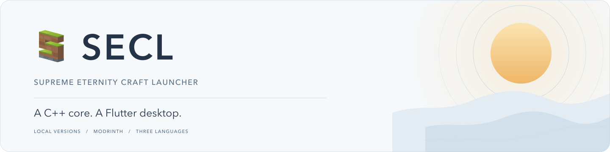
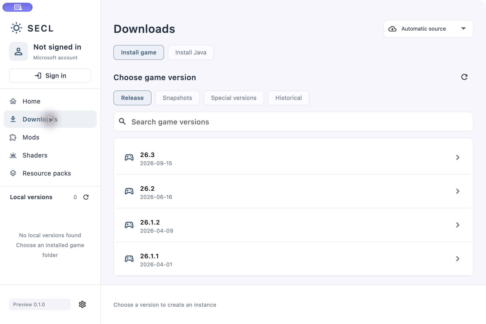
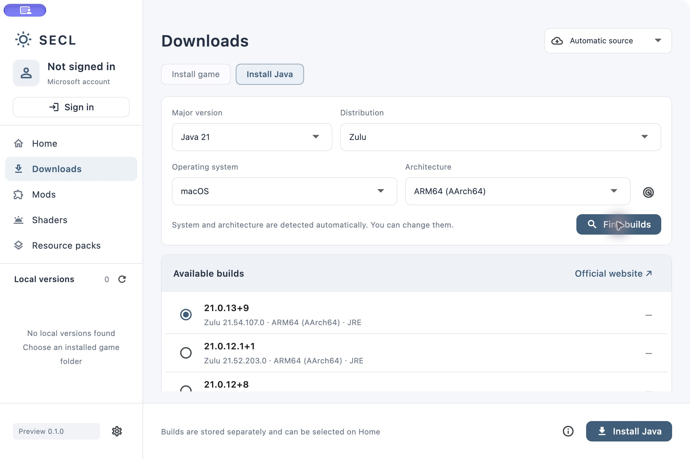
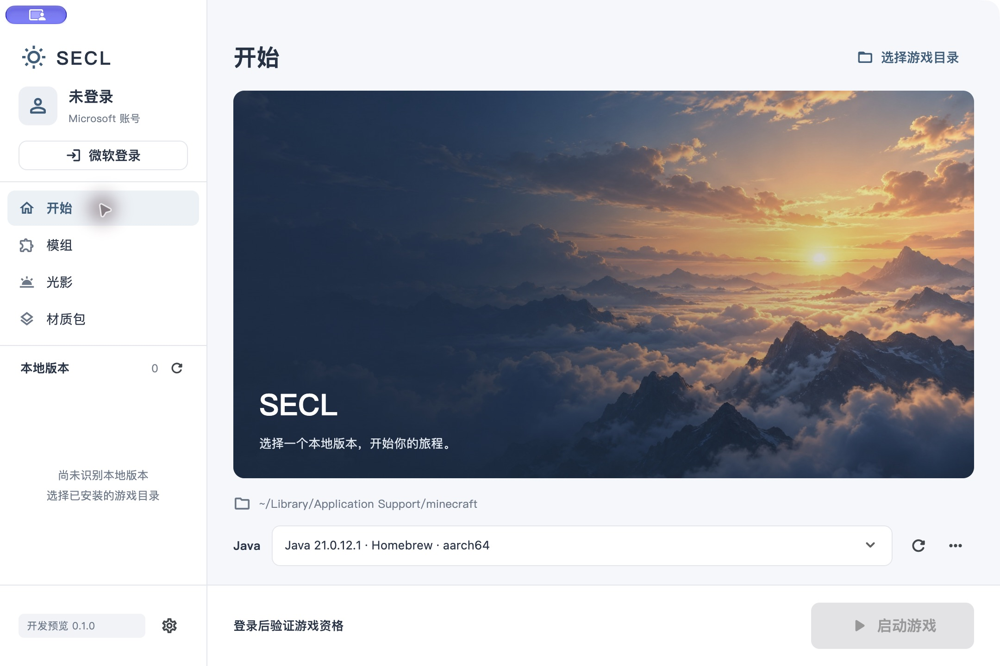
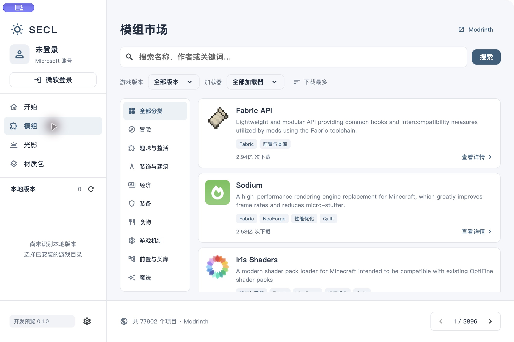
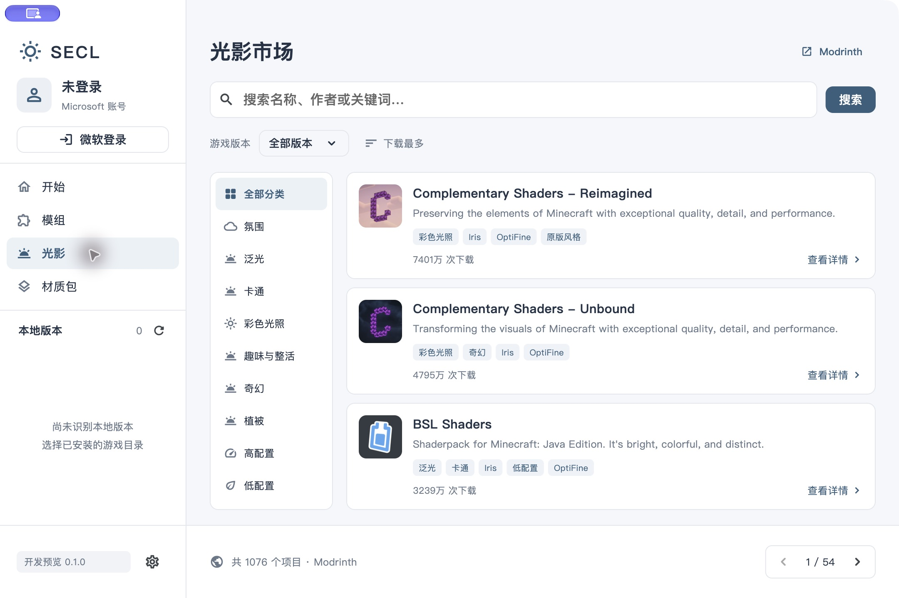
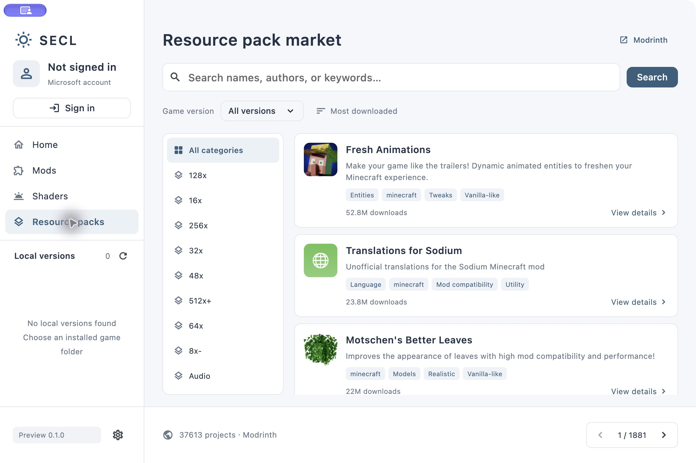

<picture>
  <source media="(prefers-color-scheme: dark)" srcset="assets/branding/readme-banner-dark.svg">
  <source media="(prefers-color-scheme: light)" srcset="assets/branding/readme-banner-light.svg">
  
</picture>

<p align="center"><a href="README.md">简体中文</a> · <strong>English</strong></p>

An independent desktop launcher for **Minecraft: Java Edition**, built with a **C++17 core and Flutter UI**.
Download or select local games and Java, then browse separate mod, shader and resource-pack markets.
The native core has no Qt dependency. The interface supports Simplified Chinese, Traditional Chinese and English.

> **0.1.0 early development preview.** Intended for development, validation and feedback. The interface, configuration format and platform coverage may change.
> This project's AppID was approved for the **Minecraft Services API allow list on 2026-11-02**. Real Microsoft sign-in, Java Edition entitlement and player profile checks passed on **2026-11-03**. Real vanilla and Fabric + Iris / Sodium game startup passed on macOS; other combinations still require validation.
> SECL's CurseForge third-party API application was approved. Configure the project key to browse CurseForge, import its modpacks, and look up installed mods.
> The primary validated platform is currently macOS on Apple Silicon. Complete application compatibility elsewhere remains unverified.

## Screenshots

Actual screenshots from the current macOS application. The home cover is an original AI-generated illustration;
resource listings come from Modrinth. Click an image for the full-resolution view.
The account state and local-version list shown here are not evidence of a successful game launch.

<table>
  <tr>
    <td width="50%"><a href="docs/screenshots/game-download.png"></a><br><strong>Game downloads</strong> · Release / snapshots / special / historical</td>
    <td width="50%"><a href="docs/screenshots/java-download.png"></a><br><strong>Java downloads</strong> · Version, distribution and build</td>
  </tr>
  <tr>
    <td width="50%"><a href="docs/screenshots/home.png"></a><br><strong>Home</strong> · Account, local versions and Java</td>
    <td width="50%"><a href="docs/screenshots/mod-market.png"></a><br><strong>Mods</strong> · Categories and version filters</td>
  </tr>
  <tr>
    <td width="50%"><a href="docs/screenshots/shader-market.png"></a><br><strong>Shaders</strong> · A separate browsing page</td>
    <td width="50%"><a href="docs/screenshots/resource-market-en.png"></a><br><strong>Resource packs</strong> · English interface</td>
  </tr>
</table>

## Current features

| Area | Implemented scope |
| --- | --- |
| Authentication | Microsoft browser authorization code + PKCE; Xbox / XSTS, Minecraft Services, Java Edition entitlement and profile checks; real account sign-in, entitlement and profile checks verified; square pixel avatar from the official skin |
| Game installation | Release, snapshot, special and historical groups; isolated instances, client / library / asset downloads and official Java runtime when needed; selectable primary loader |
| Local versions | Discover existing game folders and installed versions, then select a local version to launch |
| Java | Local runtime detection, version / distribution / architecture identification, canonical-path deduplication and manual executable selection; download a specific Zulu / Temurin / Microsoft / Oracle OpenJDK build, with automatic OS / architecture detection |
| Resource markets | Separate mod, shader and resource-pack pages with Modrinth and CurseForge; search, categories, game-version and mod-loader filters, sorting and pagination |
| Project details | Description summaries, galleries, project website links and downloadable files separated into release / beta / alpha channels |
| Modpack import | Import Modrinth `.mrpack` and CurseForge `.zip` files; review optional files and the isolated instance target, install pinned versions, verify files and apply overrides. Supply restricted files downloaded from their official pages |
| Instance installation | Choose a compatible local target; review recursive dependencies, installed components, duplicates and author-declared conflicts before installing |
| Local mod checks | Read JAR metadata for loader and dependency checks. On request, look up Modrinth by SHA-512 and CurseForge by fingerprint verified with SHA-1. Show local identity, website sources and known conflicts separately |
| World management | Per-instance world list, folder / ZIP import, streaming ZIP export, local and cross-instance copies, manual backup and restore-as-copy, and system Trash removal; game / world locks block unsafe operations |
| Downloads and feedback | Staged downloads, hash verification, existing-copy reuse, cancellation, progress, structured errors and explicit retry |
| Languages | Simplified Chinese, Traditional Chinese and English; system default, immediate switching and saved preference |

Required dependencies default on and optional dependencies default off. Skipping required dependencies needs explicit acknowledgment.
Existing components are reused by default; redownloading requires separate confirmation.
Shader packs are handled separately from Iris / OptiFine support components.
Static compatibility checks cannot guarantee that every game, loader and mod combination will run.

Embedded dependencies are checked as one version-selection problem. Quilt grouped
dependencies, conditional exceptions and aliases, plus Forge / NeoForge TOML,
manifest versions and JarJar artifacts participate in these checks. Install plans
also check transitive and existing mods' declared conflicts, updating the review
when optional choices change. Unsupported rules, unverified loader-bundled
components and analysis limits require review rather than a hard incompatibility.
Website exclusions involving possible nested candidates are shown separately;
final candidate activation still needs confirmation with the actual loader.

OptiFine version components and per-instance launch settings are available from instance management.
Game / Java downloads and loader-build selection are now available in Downloads. Platform and loader combinations still need individual validation.
See [migration notes](docs/migration.md) and the [core API](docs/core-api.md).

## Platforms and languages

| Platform | Current validation |
| --- | --- |
| macOS · Apple Silicon ARM64 | Native Debug / Release builds, UI execution and local Java detection verified; deployment target is macOS 12.0, but the minimum OS version still requires testing |
| macOS · Intel x64 | Desktop project retained; builds and execution not yet verified |
| Windows | Desktop project provided; complete native dependencies, packaging and execution not yet verified |
| Linux | Desktop project provided; distribution dependencies, packaging and graphical execution not yet verified |

Older Windows versions, 32-bit systems and other architectures require separate checks of the Flutter engine,
native dependencies and game environment. They are not currently listed as verified supported platforms.
SECL's validation results are independent of the old M²CL project.

Choose **Settings → Interface language** at the bottom left. Changes apply immediately without restarting.
The default follows the system; unsupported system languages fall back to English.
Project names, author descriptions, filenames and diagnostic codes retain their original text.

## Build and run

Use **Flutter 3.19.6 / Dart 3.3.4**, CMake 3.16+, a C++17 compiler, libcurl and zlib.
macOS requires Xcode and CocoaPods. Linux additionally requires OpenSSL, libsecret-1 and Flutter's GTK build dependencies.
Windows requires Visual Studio's C++ desktop toolchain and the corresponding native dependencies.

```sh
git clone https://github.com/SmeltKit/SECL.git
cd SECL

# Keep the pinned Flutter SDK outside this repository.
git clone --depth 1 --branch 3.19.6 https://github.com/flutter/flutter.git /path/to/flutter-3.19.6
python3 tools/build.py --flutter /path/to/flutter-3.19.6/bin/flutter --test
```

The script defaults to Release; add `--debug` for a Debug build.
For development, set `SECL_CURSEFORGE_API_KEY` in the launcher's environment
to connect directly to CurseForge. The manual macOS Release build in
SmeltKit/SECL GitHub Actions reads the `CURSEFORGE_API_KEY` repository secret
and embeds it in the native core via `--embed-curseforge-key`.
The complete application flow above has been validated on macOS ARM64. Windows / Linux still require native-library deployment and runtime validation.
The macOS app is at `app/build/macos/Build/Products/Release/SECL.app`; native build output is under `build/native/`.

Flutter 3.19.6's macOS Release AOT build tools require Rosetta on Apple Silicon build hosts;
the resulting app itself runs natively on ARM64. The current local Release is about **33.6 MB**, or **17.4 MB** as a ZIP.
Signing is ad hoc for local testing. Distribution still requires release signing and notarization.

Build and test only the C++ core:

```sh
cmake -S . -B build/core -DBUILD_TESTING=ON
cmake --build build/core --parallel 3
ctest --test-dir build/core --output-on-failure
```

Currently passing: eleven C++ test suites and 138 Flutter tests.
See [test notes](docs/testing.md) for coverage, real resource-download checks and validation limits.

## Data, services and accounts

- Games can be downloaded or selected from existing installations. Game files and Java runtimes are not bundled.
- Game sources: **Automatic / Official / BMCLAPI**. Automatic mode uses only the local time zone: mirrors first for `Asia/Shanghai`, official first elsewhere, with one fallback to the other source and no endless retries. This is not geographic location detection. Java distributions use their official sources. Mirror service: [BMCLAPI](https://bmclapidoc.bangbang93.com/).
- The resource market defaults to **Modrinth** and also supports **CurseForge**. CurseForge downloads respect the author's third-party distribution settings.
- Microsoft sign-in defaults to this project's own public-client Application ID. Users do not need application configuration or a client secret.
  Register `http://localhost/oauth/callback` for the Entra desktop application; runtime authorization uses a random loopback port and PKCE S256.
  The project public Client ID is `7ed24288-81a6-4814-8271-25a1529d2e9d` and has API allow-list approval. This does not constitute official endorsement of the launcher.
- Sign-in sessions stay in C++ memory, and tokens are not returned to Dart through FFI. Optional account persistence stores refresh credentials in the OS credential vault; without it, restarting requires signing in again. Real credential restoration still requires acceptance testing.
  Authentication or entitlement failures show an error rather than creating an offline account or a successful session.
- Ordinary settings use the platform application-data folder. Build packages, local settings, account data and signing keys are excluded by `.gitignore`.
- See [artwork provenance](docs/artwork.md) for the home illustration. Third-party project icons, names and descriptions belong to their respective authors.

## Next steps

- Expand the game / Java / loader test matrix, including in-world gameplay and long-duration stability.
- Validate per-instance launch settings and the full loader / OptiFine installation and update matrix.
- Validate Windows / Linux builds, native-library deployment and platform compatibility.
- Expand modpack import, world management and further instance features.
- Continue reviewing terminology, long text and mod / shader compatibility guidance.

Plans may change as development and testing progress; they are not claims of existing functionality.
Feedback is welcome through [Issues](https://github.com/SmeltKit/SECL/issues).

## License and attribution

Copyright (C) 2026 **ppm203**.

SECL migrates and rewrites business code from [M²CL](https://github.com/SmeltKit/m2cl), with a separate Flutter interface and a Qt-free C++ core.
Original code uses **GNU GPL version 3 only with Section 7 additional terms**:
[full license](LICENSE), [attribution and modified-version terms](ADDITIONAL_TERMS.md), and [copyright / third-party notices](NOTICE).
Third-party components retain their own licenses. Included licenses are accessible through the application's About screen.

Unofficial project. Not affiliated with or endorsed by Mojang Studios or Microsoft.
Minecraft is a trademark of its respective owner.

### Management migration (2026-11-03)

Instance library, local mods/shaders/resource packs, per-instance Java and launch options, loader/OptiFine controls, Java scans/licenses, logs, Microsoft account management and optional OS-vault persistence are connected. The UI includes full project descriptions, light/dark/system appearance and task history. Real credential restoration, the full component matrix remains unverified; macOS vanilla and Fabric + Iris/Sodium startup passed real acceptance testing. See [test record](docs/testing.md).


Installed mods, shaders and resource packs now support hash-based Modrinth update
checks scoped to the instance environment and an explicit release channel.
Review selected updates and dependencies before applying them. Disabled mods
remain disabled; failed batches roll back file replacements. Unknown files and
metadata gaps are reported separately and never presented as guaranteed
compatibility. Microsoft sign-in uses SECL's own approved public Client ID by
default; ordinary users do not need application-registration settings.
