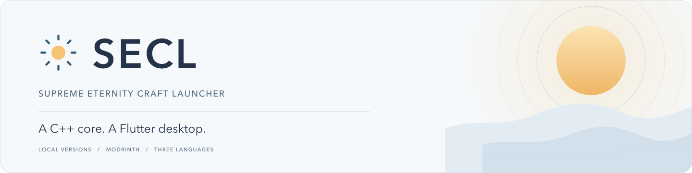
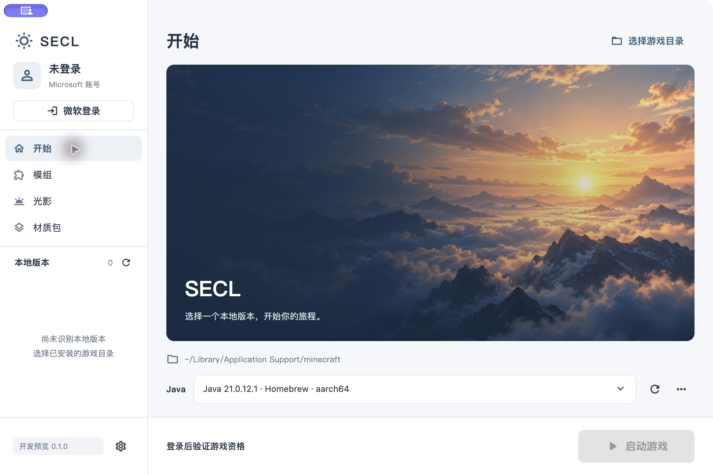
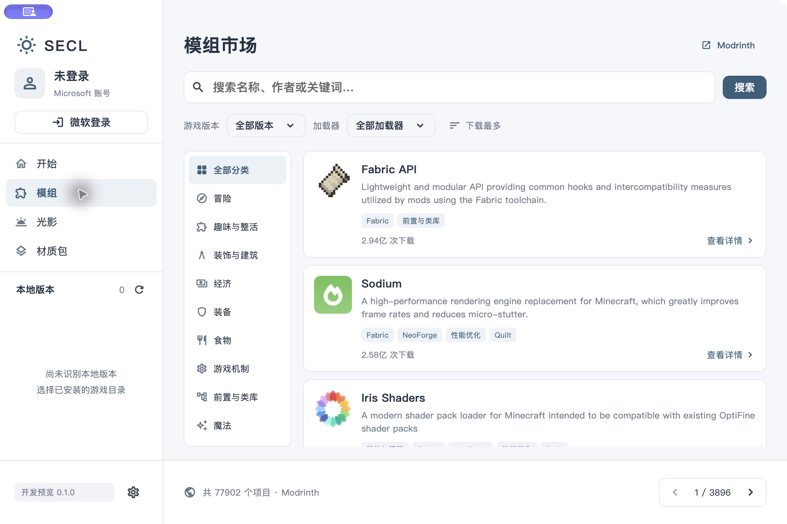
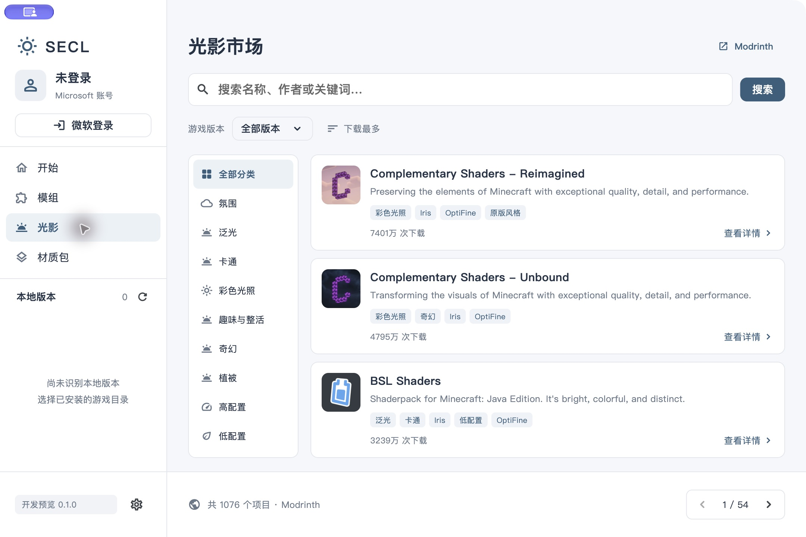
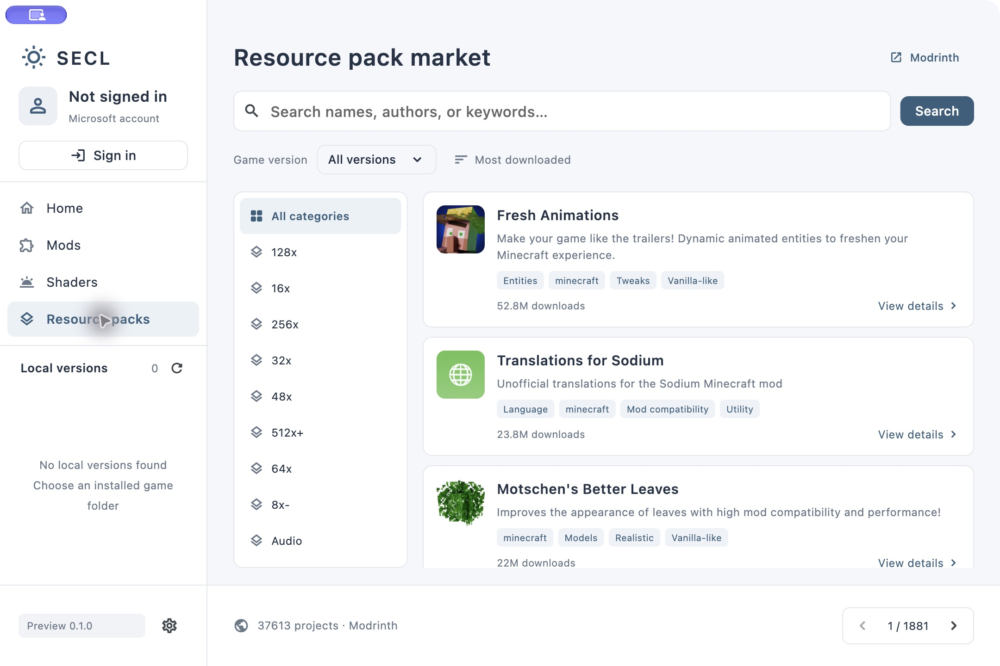

<picture>
  <source media="(prefers-color-scheme: dark)" srcset="assets/branding/readme-banner-dark.svg">
  <source media="(prefers-color-scheme: light)" srcset="assets/branding/readme-banner-light.svg">
  
</picture>

<p align="center"><a href="README.md">简体中文</a> · <strong>English</strong></p>

An independent desktop launcher for **Minecraft: Java Edition**, built with a **C++17 core and Flutter UI**.
Start with locally installed games and Java, then browse separate mod, shader and resource-pack markets.
The native core has no Qt dependency. The interface supports Simplified Chinese, Traditional Chinese and English.

> **0.1.0 early development preview.** Intended for development, validation and feedback. The interface, configuration format and platform coverage may change.
> Microsoft authentication and entitlement checks are implemented, but real sign-in with this project's own application ID and actual game startup have not passed end-to-end validation.
> The primary validated platform is currently macOS on Apple Silicon. Complete application compatibility elsewhere remains unverified.

## Screenshots

Actual screenshots from the current macOS application. The home cover is an original AI-generated illustration;
resource listings come from Modrinth. Click an image for the full-resolution view.
The account state and local-version list shown here are not evidence of a successful game launch.

<table>
  <tr>
    <td width="50%"><a href="docs/screenshots/home.png"></a><br><strong>Home</strong> · Account, local versions and Java</td>
    <td width="50%"><a href="docs/screenshots/mod-market.png"></a><br><strong>Mods</strong> · Categories and version filters</td>
  </tr>
  <tr>
    <td width="50%"><a href="docs/screenshots/shader-market.png"></a><br><strong>Shaders</strong> · A separate browsing page</td>
    <td width="50%"><a href="docs/screenshots/resource-market-en.png"></a><br><strong>Resource packs</strong> · English interface</td>
  </tr>
</table>

## Current features

| Area | Implemented scope |
| --- | --- |
| Authentication | Microsoft browser authorization code + PKCE; Xbox / XSTS, Minecraft Services, Java Edition entitlement and profile checks; real sign-in validation pending |
| Local versions | Discover existing game folders and installed versions, then select a local version to launch |
| Java | Local runtime detection, version / distribution / architecture identification, canonical-path deduplication and manual executable selection |
| Resource markets | Separate Modrinth mod, shader and resource-pack pages; search, categories, game-version and mod-loader filters, sorting and pagination |
| Project details | Description summaries, galleries, project website links and downloadable files separated into release / beta / alpha channels |
| Instance installation | Choose a compatible local target; review recursive dependencies, installed components, duplicates and author-declared conflicts before installing |
| Downloads and feedback | Staged downloads, hash verification, existing-copy reuse, cancellation, progress, structured errors and explicit retry |
| Languages | Simplified Chinese, Traditional Chinese and English; system default, immediate switching and saved preference |

Required dependencies default on and optional dependencies default off. Skipping required dependencies needs explicit acknowledgment.
Existing components are reused by default; redownloading requires separate confirmation.
Shader packs are handled separately from Iris / OptiFine support components.
Static compatibility checks cannot guarantee that every game, loader and mod combination will run.

**Currently available only through the C++ backend:** runtime downloads, game installation, loader installation,
OptiFine version components and additional per-instance launch settings. These are not all exposed in the current UI.
See [migration notes](docs/migration.md) and the [core API](docs/core-api.md).

## Platforms and languages

| Platform | Current validation |
| --- | --- |
| macOS · Apple Silicon ARM64 | Native Debug / Release builds, UI execution and local Java detection verified; deployment target is macOS 12.0, but the minimum OS version still requires testing |
| macOS · Intel x64 | Desktop project retained; builds and execution not yet verified |
| Windows | Desktop project provided; complete native dependencies, packaging and execution not yet verified |
| Linux | Desktop project provided; distribution dependencies, packaging and graphical execution not yet verified |

Older Windows versions, 32-bit systems and other architectures require separate checks of the Flutter engine,
native dependencies and game environment. They are not currently listed as verified supported platforms.
SECL's validation results are independent of the old M²CL project.

Choose **Settings → Interface language** at the bottom left. Changes apply immediately without restarting.
The default follows the system; unsupported system languages fall back to English.
Project names, author descriptions, filenames and diagnostic codes retain their original text.

## Build and run

Use **Flutter 3.19.6 / Dart 3.3.4**, CMake 3.16+, a C++17 compiler, libcurl and zlib.
macOS requires Xcode and CocoaPods. Linux additionally requires OpenSSL, libsecret-1 and Flutter's GTK build dependencies.
Windows requires Visual Studio's C++ desktop toolchain and the corresponding native dependencies.

```sh
git clone https://github.com/SmeltKit/SECL.git
cd SECL

# Keep the pinned Flutter SDK outside this repository.
git clone --depth 1 --branch 3.19.6 https://github.com/flutter/flutter.git /path/to/flutter-3.19.6
python3 tools/build.py --flutter /path/to/flutter-3.19.6/bin/flutter --test
```

The script defaults to Release; add `--debug` for a Debug build.
The complete application flow above has been validated on macOS ARM64. Windows / Linux still require native-library deployment and runtime validation.
The macOS app is at `app/build/macos/Build/Products/Release/SECL.app`; native build output is under `build/native/`.

Flutter 3.19.6's macOS Release AOT build tools require Rosetta on Apple Silicon build hosts;
the resulting app itself runs natively on ARM64. The current local Release is about **22.7 MB**, or **9.1 MB** as a ZIP.
Signing is ad hoc for local testing. Distribution still requires release signing and notarization.

Build and test only the C++ core:

```sh
cmake -S . -B build/core -DBUILD_TESTING=ON
cmake --build build/core --parallel 3
ctest --test-dir build/core --output-on-failure
```

Currently passing: 110 authentication / core checks, 57 engine checks and 16 Flutter tests.
See [test notes](docs/testing.md) for coverage, real resource-download checks and validation limits.

## Data, services and accounts

- Games use existing local installations. Game files and Java runtimes are not bundled.
- The resource markets currently use **Modrinth**. CurseForge is not connected and requires the relevant authorization and implementation.
- Microsoft sign-in requires this project's own public-client Application ID. No client secret is needed.
  Register `http://localhost/oauth/callback` for the Entra desktop application; runtime authorization uses a random loopback port and PKCE S256.
  Minecraft Services API access needs separate approval; registering an app ID does not grant API access.
- The current UI keeps sign-in sessions in C++ memory. Tokens are not returned to Dart through FFI; restarting the app requires signing in again.
  Authentication or entitlement failures show an error rather than creating an offline account or a successful session.
- Ordinary settings use the platform application-data folder. Build packages, local settings, account data and signing keys are excluded by `.gitignore`.
- See [artwork provenance](docs/artwork.md) for the home illustration. Third-party project icons, names and descriptions belong to their respective authors.

## Next steps

- Configure and request project-owned API access, then validate real account sign-in and game startup.
- Expose migrated Java, game and loader installation through the UI, and add per-instance launch settings.
- Validate Windows / Linux builds, native-library deployment and platform compatibility.
- Integrate CurseForge after authorization; gradually add world management and further instance features.
- Continue reviewing terminology, long text and mod / shader compatibility guidance.

Plans may change as development and testing progress; they are not claims of existing functionality.
Feedback is welcome through [Issues](https://github.com/SmeltKit/SECL/issues).

## License and attribution

Copyright (C) 2026 **ppm203**.

SECL migrates and rewrites business code from [M²CL](https://github.com/SmeltKit/m2cl), with a separate Flutter interface and a Qt-free C++ core.
Original code uses **GNU GPL version 3 only with Section 7 additional terms**:
[full license](LICENSE), [attribution and modified-version terms](ADDITIONAL_TERMS.md), and [copyright / third-party notices](NOTICE).
Third-party components retain their own licenses. Included licenses are accessible through the application's About screen.

Unofficial project. Not affiliated with, approved by or endorsed by Mojang Studios or Microsoft.
Minecraft is a trademark of its respective owner.
