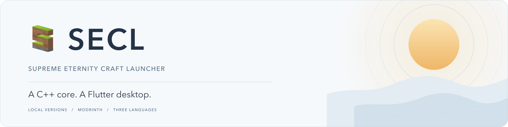
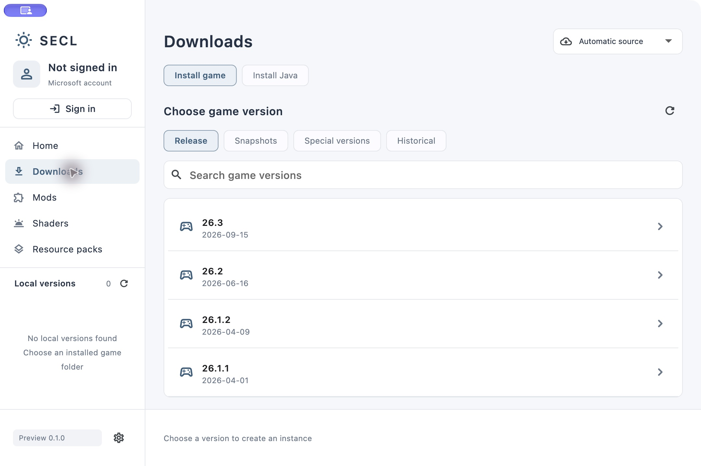
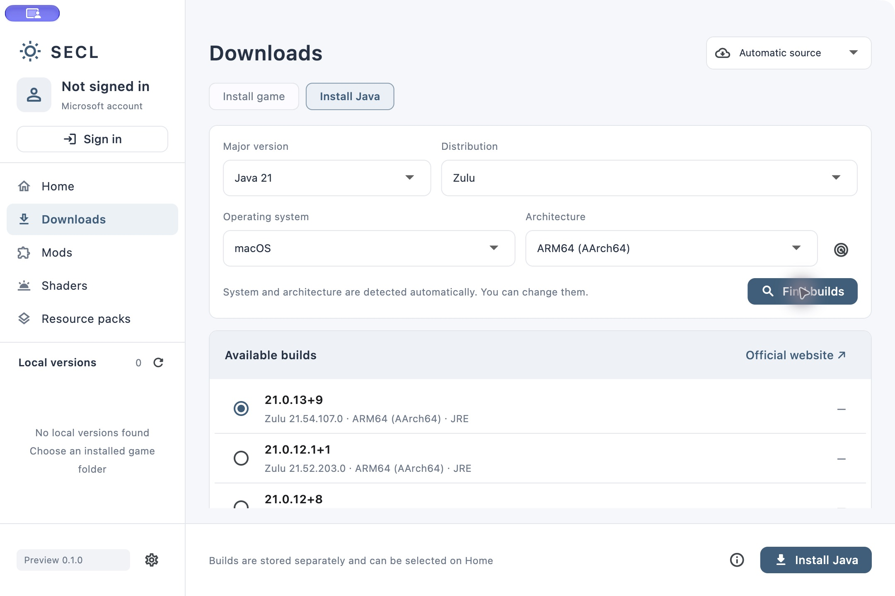
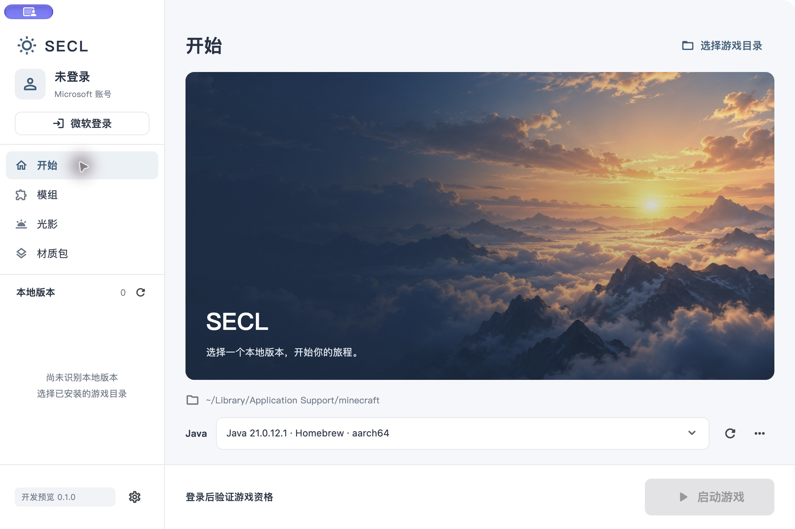
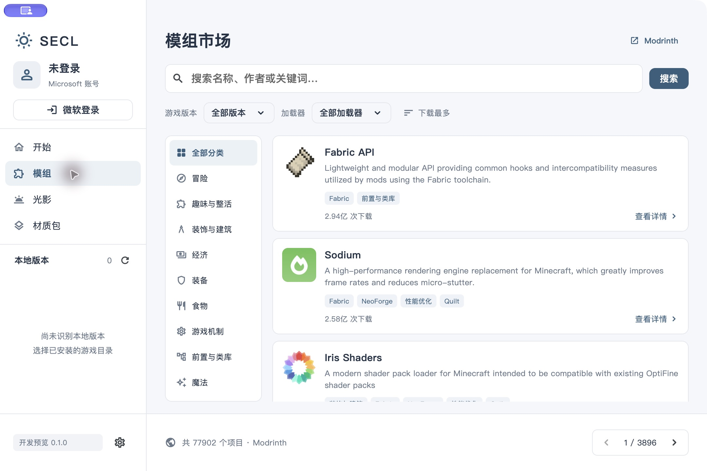
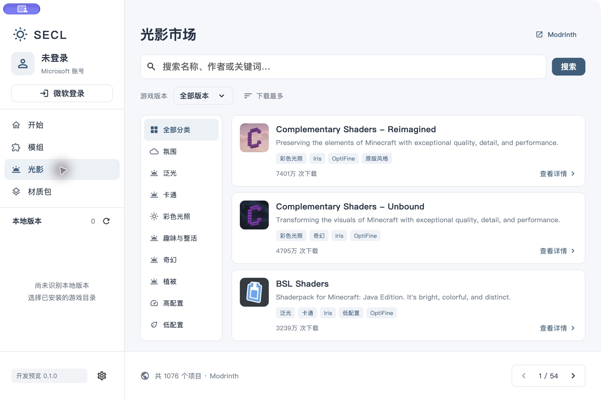
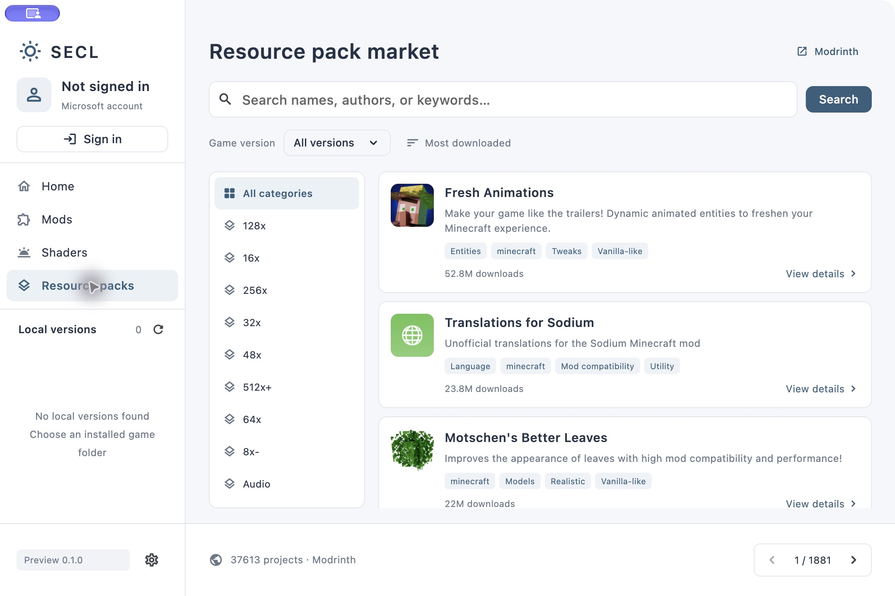

<picture>
  <source media="(prefers-color-scheme: dark)" srcset="assets/branding/readme-banner-dark.svg">
  <source media="(prefers-color-scheme: light)" srcset="assets/branding/readme-banner-light.svg">
  
</picture>

<p align="center"><strong>简体中文</strong> · <a href="README.en.md">English</a></p>

一个使用 **C++17 核心与 Flutter 桌面界面**开发的独立 Minecraft: Java Edition 启动器。
支持下载或选择本地游戏与 Java，并提供独立的模组、光影与材质包市场。
核心不依赖 Qt；界面支持简体中文、繁体中文和英文。

> **0.1.0 早期开发预览。** 当前用于开发、验证和功能反馈，界面、配置格式及平台支持仍可能调整。
> 本项目自有 AppID 已于 **2026-11-02** 获准加入 Minecraft Services API 白名单；**2026-11-03** 已完成真实 Microsoft 登录、Java 版资格与角色信息校验。实际游戏启动仍待验收。
> CurseForge 新申请已提交，等待审核；当前资源市场使用 Modrinth。
> 当前主要验证平台为 macOS Apple Silicon；其他平台的完整应用兼容性仍待实测。

## 界面预览

以下为当前 macOS 应用的实际截图。主页封面是原创 AI 主题插画，资源列表来自 Modrinth。
点击图片可查看原图；截图中的登录状态与版本列表不代表已经完成游戏启动验证。

<table>
  <tr>
    <td width="50%"><a href="docs/screenshots/game-download.png"></a><br><strong>游戏下载</strong> · 正式 / 测试 / 特殊 / 历史版本</td>
    <td width="50%"><a href="docs/screenshots/java-download.png"></a><br><strong>Java 下载</strong> · 主版本、发行版与具体构建</td>
  </tr>
  <tr>
    <td width="50%"><a href="docs/screenshots/home.png"></a><br><strong>主页</strong> · 账号、本地版本与 Java</td>
    <td width="50%"><a href="docs/screenshots/mod-market.png"></a><br><strong>模组市场</strong> · 分类与版本筛选</td>
  </tr>
  <tr>
    <td width="50%"><a href="docs/screenshots/shader-market.png"></a><br><strong>光影市场</strong> · 独立浏览入口</td>
    <td width="50%"><a href="docs/screenshots/resource-market-en.png"></a><br><strong>材质包市场</strong> · 英文界面</td>
  </tr>
</table>

## 已有功能

| 方向 | 当前实现 |
| --- | --- |
| 账号与认证 | Microsoft 浏览器授权码 + PKCE，Xbox / XSTS、Minecraft Services、Java 版资格与角色校验流程；真实账号登录、资格和角色校验已实测通过 |
| 游戏安装 | 正式版、测试版、特殊版和历史版本分组；创建隔离实例，下载客户端、依赖、资源及所需官方 Java；可选择主加载器 |
| 本地版本 | 识别已有游戏目录与已安装版本，选择本地版本启动 |
| Java | 检测本地 Java，识别版本、发行来源与架构，合并指向同一运行时的路径，支持手动选择可执行文件；按主版本、Zulu / Temurin / Microsoft / Oracle OpenJDK 和具体构建下载，自动检测系统与架构 |
| 资源市场 | Modrinth 模组、光影、材质包独立入口；搜索、分类、游戏版本筛选、模组加载器筛选、排序与分页 |
| 项目详情 | 项目介绍摘要、图集、项目主页链接，按正式版 / 测试版 / 预览版查看可下载文件 |
| 实例安装 | 下载时选择匹配的本地实例，先展示安装方案；递归依赖、已有组件、重复文件与作者声明冲突检查 |
| 下载与反馈 | 暂存下载、哈希验证、重复副本复用、取消、进度显示；明确的错误提示与手动重试 |
| 界面语言 | 简体中文、繁体中文、英文；默认跟随系统，设置中切换后立即生效并保存 |

必需依赖默认选中，可选依赖默认不选；用户取消必需依赖时需明确确认风险。
已有组件默认复用，重新下载需要单独确认。光影包与 Iris / OptiFine 支持组件分开处理。
静态兼容检查不能保证每一种游戏、加载器和模组组合都能运行。

**目前仍仅在 C++ 后端提供的能力：** OptiFine 版本组件及更多实例启动设置。
游戏下载、Java 下载和加载器构建选择现已接入下载页；各平台与加载器组合仍须逐项验证。
完整范围见[迁移说明](docs/migration.md)和[核心接口](docs/core-api.md)。

## 平台与语言

| 平台 | 当前验证状态 |
| --- | --- |
| macOS · Apple Silicon ARM64 | 已完成原生 Debug / Release 构建、界面运行与本机 Java 检测；部署目标为 macOS 12.0，最低系统版本仍待实测 |
| macOS · Intel x64 | 工程已保留，构建与运行待验证 |
| Windows | 提供桌面工程，完整原生依赖、打包及运行仍待验证 |
| Linux | 提供桌面工程，发行版依赖、打包及图形运行仍待验证 |

旧版 Windows、32 位系统与其他架构需要分别验证 Flutter 引擎、C++ 依赖和游戏运行环境，
当前不将它们列为已经支持的平台。SECL 的验证记录独立于旧 M²CL 项目。

在左下角的 **设置 → 界面语言** 中切换语言，无需重启。
默认跟随系统；无法匹配的系统语言回退英文。项目名称、作者介绍、文件名和诊断代码保留原文。

## 构建与运行

固定使用 **Flutter 3.19.6 / Dart 3.3.4**，以及 CMake 3.16+、C++17 编译器、libcurl 和 zlib。
macOS 需要 Xcode 与 CocoaPods；Linux 另需 OpenSSL、libsecret-1 及 Flutter GTK 构建依赖；
Windows 需要 Visual Studio C++ 桌面工具链及对应原生依赖。

```sh
git clone https://github.com/SmeltKit/SECL.git
cd SECL

# 在仓库外准备固定版本的 Flutter SDK。
git clone --depth 1 --branch 3.19.6 https://github.com/flutter/flutter.git /path/to/flutter-3.19.6
python3 tools/build.py --flutter /path/to/flutter-3.19.6/bin/flutter --test
```

脚本默认构建 Release；添加 `--debug` 可构建调试版。
上述完整应用流程已在 macOS ARM64 验证；Windows / Linux 仍需分别完成原生库部署与运行验收。
macOS 产物位于 `app/build/macos/Build/Products/Release/SECL.app`，原生核心位于 `build/native/`。

Flutter 3.19.6 的 macOS Release AOT 构建工具需要 Rosetta 才能在 Apple Silicon 上执行；
生成的应用本身是原生 ARM64。当前本地 Release 约 **22.9 MB**，ZIP 约 **9.2 MB**。
当前签名仅用于本机测试，正式分发仍需处理签名与公证。

只构建并测试 C++ 核心：

```sh
cmake -S . -B build/core -DBUILD_TESTING=ON
cmake --build build/core --parallel 3
ctest --test-dir build/core --output-on-failure
```

当前通过 111 项认证 / 核心检查、64 项引擎检查与 22 项 Flutter 测试。
测试范围、真实资源下载记录及尚未验收的项目见[测试说明](docs/testing.md)。

## 数据、来源与账号

- 可以下载游戏或使用已有本地安装；构建包不捆绑游戏文件或 Java 运行时。
- 游戏下载源可选择 **自动 / 官方 / BMCLAPI**。自动模式仅使用本机时区：`Asia/Shanghai` 优先镜像，其他时区优先官方；失败后切换一次备用源，不进行无限重试。时区不是精确地理定位。Java 发行版从各自官方来源下载。镜像服务由 [BMCLAPI](https://bmclapidoc.bangbang93.com/) 提供。
- 资源市场目前接入 **Modrinth**。CurseForge 新申请已于 2026-11-03 提交，尚待审核和接入。
- 微软登录需配置本项目自有的公共客户端 Application（client）ID；无需 Client Secret。
  Entra 桌面应用回调为 `http://localhost/oauth/callback`，运行时使用随机本机端口与 PKCE S256。
  本项目使用的公共 Client ID 为 `7ed24288-81a6-4814-8271-25a1529d2e9d`，已获 API 白名单许可。该许可不代表 Mojang / Microsoft 对本启动器的官方背书。
- 当前界面中的登录会话保存在 C++ 内存，令牌不通过 FFI 传给 Dart；退出应用后需要重新登录。
  认证与资格校验失败会显示错误，不会创建离线账号或生成成功状态。
- 普通设置保存在系统应用数据目录。构建包、本机配置、账号数据和签名密钥通过 `.gitignore` 排除。
- 主页封面的来源说明见[插画记录](docs/artwork.md)。截图中的第三方项目图标、名称与介绍属于各自作者。

## 接下来的工作

- 完成真实游戏启动验证，继续覆盖不同游戏、Java 与加载器组合。
- 补充实例启动设置与更多已迁移的版本组件界面。
- 完成 Windows / Linux 构建、原生库部署与平台兼容性测试。
- 在获得授权后接入 CurseForge；逐步增加存档管理与更多实例功能。
- 持续校对三种语言、长文本布局，以及模组与光影兼容性提示。

计划按开发与验证情况调整，不代表已经提供这些功能。
问题反馈与建议可提交到 [Issues](https://github.com/SmeltKit/SECL/issues)。

## 许可证与署名

Copyright (C) 2026 **ppm203**。

SECL 基于 [M²CL](https://github.com/SmeltKit/m2cl) 的业务代码迁移与重写，采用独立的 Flutter 界面与无 Qt 的 C++ 核心。
原创代码采用 **GNU GPLv3（仅第 3 版）及第 7 节附加条款**：
[完整许可证](LICENSE)、[署名与修改版标识条款](ADDITIONAL_TERMS.md)、[版权及第三方声明](NOTICE)。
第三方组件保留各自许可；应用的“关于”页面可查看已收录的许可证。

这是非官方项目，与 Mojang Studios、Microsoft 无官方隶属或合作关系，不代表其官方产品，亦未获得其背书。
Minecraft 商标属于其权利人。
